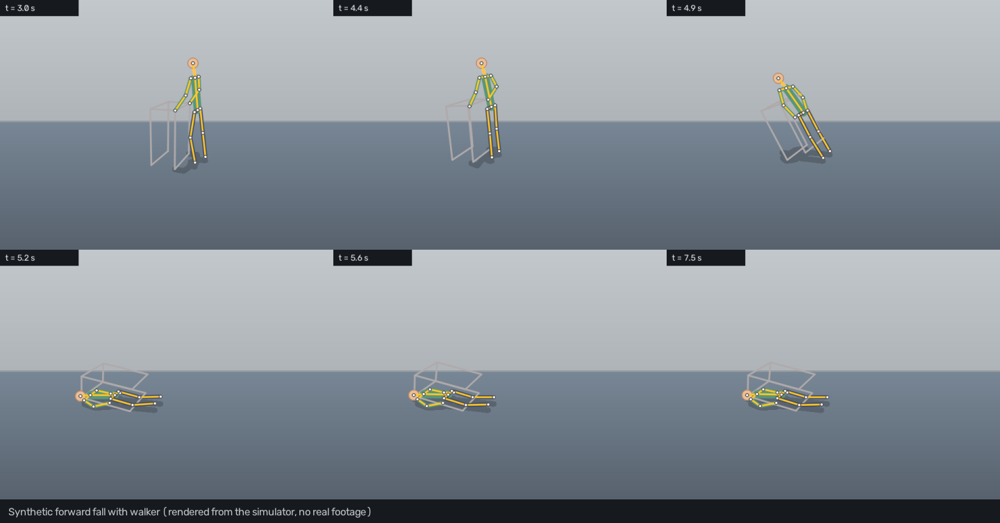
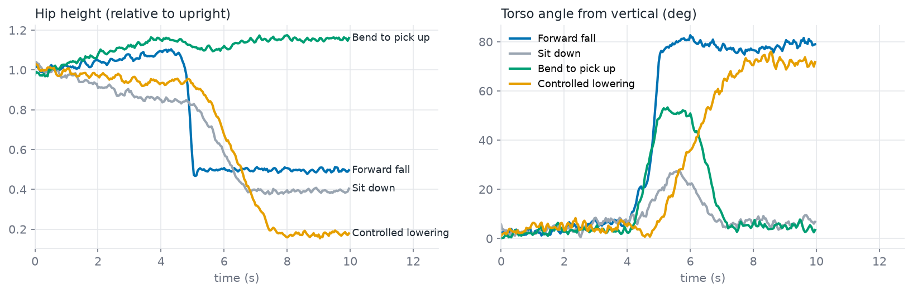
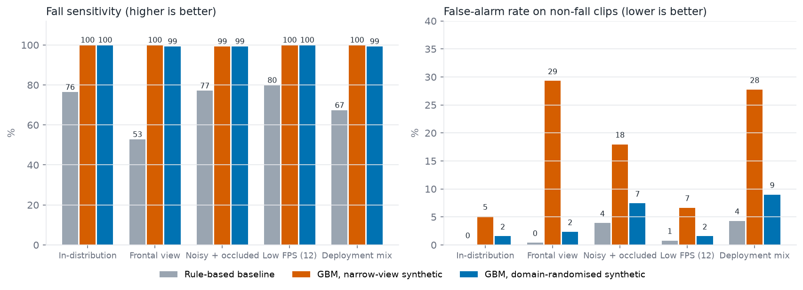
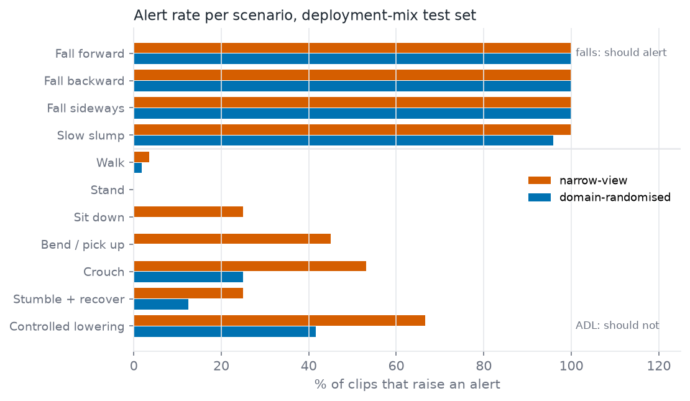

# Walker Fall Detection with Synthetic Data

A reproducible computer-vision pipeline that uses **simulated older-adult motion** to build, stress-test and de-risk a **pose-based fall detector**, without any surveillance footage of vulnerable people.

<!--
  ADD YOUR VIDEO HERE
  1. Put your file at assets/demo.mp4
  2. On GitHub, drag the video into this README in the web editor to get a playable embed,
     or link it: [Watch the demo](assets/demo.mp4)
-->
> [▶ Watch the demo](assets/Demo.mp4)



> **Scope.** Everything here is simulated. The results compare training regimes under camera, noise and frame-rate shift inside a synthetic world. They are **not** a claim of real-world or clinical accuracy. See [Limitations](#limitations).

## Contents

* [Why synthetic data](#why-synthetic-data)
* [Project layout](#project-layout)
* [Quick start](#quick-start)
* [How it works](#how-it-works)
* [Experiment and results](#experiment-and-results)
* [Limitations](#limitations)
* [Roadmap](#roadmap)
* [Further reading](#further-reading)

## Why synthetic data

| Need | How the project addresses it |
|---|---|
| Privacy | No real person is filmed. Every clip comes from a parametric skeleton, so datasets can be shared and versioned freely. |
| Edge cases | Falls are rare and dangerous to record. The simulator covers forward, backward, sideways and slow-slump falls plus hard negatives: sitting, bending, crouching, stumbling and recovering, and deliberately lowering oneself to the floor. |
| Controlled stress tests | Camera yaw, pitch, distance, frame rate, keypoint noise and occlusion are explicit parameters, so a failure can be traced to a specific shift. |
| Walker mechanics | The walker is simulated with the person: hands grip the handles, release as balance is lost, and the walker tips over. |
| Pose and flow evaluation | Detectors consume 2D keypoints, which is what a pose estimator outputs. A pixel renderer and Farneback optical flow give motion-energy signals from the same clips. |

## Project layout

```
falldet/
  simulate.py   3D biomechanical simulator (gait, posture, tipping falls, walker, hands)
  camera.py     pinhole camera with yaw, pitch and distance
  config.py     domains (narrow, randomised, test shifts) and scenario catalogue
  features.py   causal, scale-normalised window features from 2D keypoints (26)
  models.py     rule-based baseline and gradient-boosted detector
  evaluate.py   clip-level sensitivity, false alarms, latency, Wilson 95% intervals
  pipeline.py   simulate, observe (noise and occlusion), window, label
  render.py     pixel renderer (mannequin, walker, room, lighting, sensor noise)
  flow.py       dense optical-flow motion energy
scripts/
  run_experiments.py   train and benchmark, writes results/metrics.json
  make_figures.py      README charts
  make_filmstrip.py    still-frame contact sheet of one fall
tests/                 25 unit tests
docs/                  methodology, model card, prompts for generative video models
```

## Quick start

```bash
python -m venv .venv && source .venv/bin/activate
pip install -r requirements.txt

make test        # 25 tests, a few seconds
make eval        # about 1 minute: builds data, trains, runs the benchmark
make figures     # charts in assets/
make filmstrip   # contact sheet in assets/
```

Python 3.10 or newer. Seed 7. Outputs: `results/metrics.json` and trained detectors in `models/`.

## How it works

1. **Simulate.** A 15-joint skeleton is driven by gait, posture and a whole-body tipping rotation about the ankles, with an accelerating descent, impact bounce and ground contact. Falls last 0.45–1.8 s; deliberate lowering lasts 3.5–5.5 s.
2. **Observe.** The skeleton is projected through a randomised camera, then pose-estimator-style jitter, occlusion blocks and dropouts are added (hold-last-value fill).
3. **Featurise.** Each track calibrates on its first second (body scale, floor line). Windows are 3 s long with 0.2 s stride and strictly causal: hip and head height, torso angle, bounding-box aspect, vertical velocities, motion energy, time since peak descent, and more.
4. **Detect.** Two detectors: a transparent rule-based baseline and a gradient-boosted classifier. An alert needs two consecutive windows above threshold, with a 3 s refractory period.
5. **Evaluate at clip level.** A fall is detected if an alert falls between loss of balance and 3 s after impact. Any other alert is a false alarm. Thresholds come from validation data in each model's own training distribution (at most 3% false-alarm clips) and are then frozen for every shifted test set.



*Hip height and torso angle separate a fall from sitting and bending. Controlled lowering is the hard case: it ends in the same posture, only slower.*

## Experiment and results

Two gradient-boosted detectors were trained on 1,500 clips each:

* **Narrow-view:** camera yaw within ±35°, clean keypoints, 25 fps.
* **Domain-randomised:** yaw 0–90°, pitch 5–30°, distance 3.5–6 m, 15/25/30 fps, keypoint noise 0.5–4.5 px, up to 2 occlusion blocks.

Each was tested on 400 fresh clips per condition (144 falls, 256 non-falls). Cells show fall sensitivity / false-alarm rate on non-fall clips, in %. Wilson 95% intervals are in `results/metrics.json`.

| Test condition | Rule-based | GBM, narrow-view training | GBM, domain-randomised training |
|---|---|---|---|
| In-distribution | 76.4 / 0.0 | 100 / 5.1 | 100 / 1.6 |
| Frontal view (60–90° yaw) | 52.8 / 0.4 | 100 / **29.3** | 99.3 / **2.3** |
| Noisy and occluded keypoints | 77.1 / 3.9 | 99.3 / **18.0** | 99.3 / 7.4 |
| Low frame rate (12 fps) | 79.9 / 0.8 | 100 / 6.6 | 100 / 1.6 |
| Deployment mix | 67.4 / 4.3 | 100 / **27.7** | 99.3 / 9.0 |



**Findings**

* The narrow-view model looks perfect in-distribution, then raises false alarms on about 29% of non-fall clips when the camera moves to a frontal view. Sensitivity alone hides this.
* Randomising camera, frame rate, noise and occlusion in the synthetic data cuts frontal-view false alarms from 29.3% to 2.3% with no loss of sensitivity.
* The rule-based baseline is conservative but misses a quarter to a half of falls.
* Median alert latency from the start of the descent is about 0.6–0.7 s for the gradient-boosted models.
* The top features by permutation importance are time since peak descent and peak downward hip and head velocity, so the model mostly learns the speed of collapse.

### Where it still fails



On the deployment-mix set the domain-randomised model still alerts on **42% of controlled-lowering clips and 25% of crouches**, which end in a low, fall-like posture. Speed is the main separating cue. On simulator ground truth, the peak hip drop over 0.5 s has a median of 0.28 m/s for controlled lowering, 0.7 m/s for slow slumps and 1.1–1.3 m/s for the other falls, and keypoint noise blurs that gap. A post-event check (does the person get up?) would help more than posture alone.

## Limitations

* **Synthetic only.** No real footage was used for training or testing, and sim-to-real transfer is untested. Read the numbers as a comparison between training regimes, not as expected field accuracy.
* **Keypoint-level simulation.** Noise and occlusion are statistical stand-ins for a real pose estimator. The pixel renderer is a stylised mannequin, so it supports lighting and optical-flow experiments but is not photo-realistic. The benchmark covers camera, noise, frame rate and occlusion; it does not vary lighting.
* **One simulator.** Body proportions, fall dynamics and the walker model are simplified, and the detector can overfit to their quirks.
* **Single person, fixed scenes.** No multi-person tracking, furniture or moving cameras.
* **Not a medical device.** Do not use for safety-critical decisions.

## Roadmap

1. Run a real pose estimator (for example RTMPose or ViTPose) on rendered or generated video in place of the statistical noise model.
2. Add a post-fall "no recovery" stage to separate falls from controlled lowering.
3. Validate on a public real-world fall dataset and measure the sim-to-real gap.
4. Add lighting variation to the benchmark using the pixel renderer.
5. Generate photo-realistic variants with a video model.

## Further reading

* [`docs/METHODOLOGY.md`](docs/METHODOLOGY.md): simulator equations, labels, metrics, threshold policy.
* [`docs/MODEL_CARD.md`](docs/MODEL_CARD.md): intended use, data, failure modes, ethics.
* [`docs/video_generation_prompts.md`](docs/video_generation_prompts.md): prompts and a quality checklist for generative video models.
* [`CHANGELOG.md`](CHANGELOG.md)

## License

MIT. The simulator and renderer are original code. No third-party footage or assets are included.
